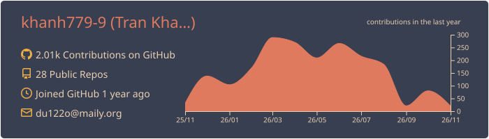
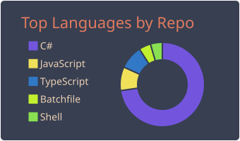
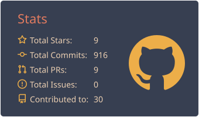

## About Me

I'm an IT enthusiast with interests in **Software Development, System Administration, and Network Infrastructure**. I enjoy exploring how software applications are built, deployed, connected, and maintained across different environments.

I believe in combining software engineering knowledge with infrastructure and networking skills to build, deploy, and manage reliable systems.

- Developing backend applications and exploring software architecture
- Learning Linux and Windows Server administration
- Exploring network configuration, troubleshooting, and infrastructure management
- Practicing containerization, virtualization, and server deployment
- Building hands-on projects and labs to strengthen my technical skills

---

## Technical Skills

### Programming Languages

### Backend & Frontend Development

### Operating Systems & System Administration

### Networking & Infrastructure

### Database & Message Brokers

<!---->

### Containerization & Virtualization

### Development & Administration Tools

---

## Projects & Hands-on Labs

I enjoy learning through practical projects, experiments, and infrastructure labs.

Areas of interest:

- **Software Development:** Backend applications, REST APIs, database design, and application architecture.
- **System Administration:** Linux and Windows Server configuration, service management, and system troubleshooting.
- **Networking:** Network topology design, IP addressing, routing, switching, DNS, and DHCP.
- **Infrastructure:** Docker, virtualization, reverse proxies, and server deployment.
- **Automation:** Bash, PowerShell, and scripting for system administration.

---

## GitHub Stats & Analytics

  
  
  
  
  
  

---

**Thanks for visiting my profile!**

Feel free to explore my repositories, projects, and hands-on labs.

