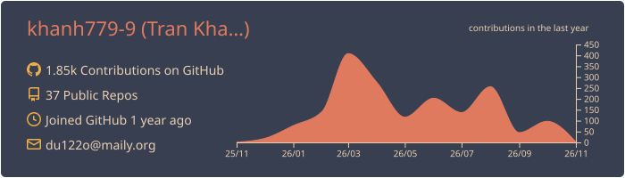
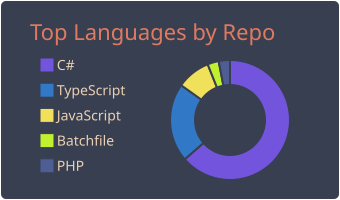
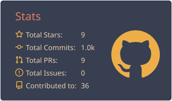

## About Me

I'm interested in software development and enjoy exploring different technologies through hands-on projects.

- Exploring backend and web development
- Learning about databases, system infrastructure, and application security
- Building personal projects to improve my technical skills

---

## Tech Stack

### Languages

### Backend & Frontend

### Database & Infrastructure

### Tools

---

## GitHub Stats & Analytics

  
  
  
  
  
  

---

  **Thanks for visiting my profile!**

  Feel free to explore my repositories.

